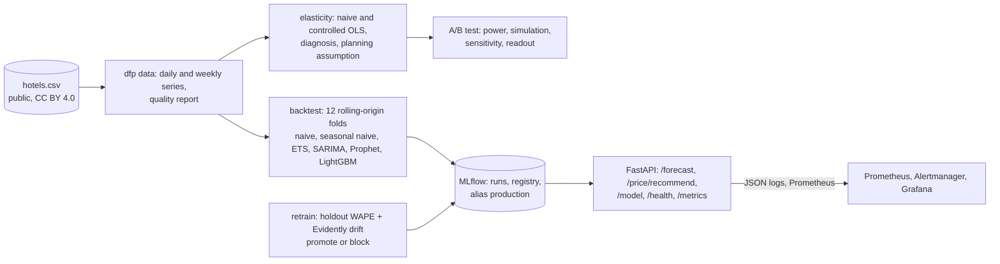

# demand-forecast-pricing

Hotel demand forecasting, price elasticity and a pricing A/B test on public booking data, done the way a
forecasting and pricing data scientist would hand it to a revenue team: every model backtested against the
baselines it has to beat, an elasticity section that says what the data can and cannot identify, a test
designed with a power analysis and read out in plain language, and the operations around it: MLflow
tracking and registry, a FastAPI service, a drift-gated retrain job, tests, metrics and alerts.

Python 3.12, pandas, statsmodels (ETS, SARIMA, OLS), Prophet, LightGBM, scikit-learn, MLflow 3, Evidently,
FastAPI, Prometheus, Docker Compose, Fly.io, Terraform (AWS App Runner), GitHub Actions.

## Data

Hotel booking demand dataset (Antonio, de Almeida and Nunes, *Data in Brief* 22, 2019, CC BY 4.0): 119,390
bookings at a city hotel and a resort hotel in Portugal, arrivals 2015-07-01 to 2017-08-31, with arrival
date, nights, guests, market segment, average daily rate (ADR) and cancellation. `scripts/download_data.py`
fetches it from the TidyTuesday mirror; no account. From it: daily arrivals, room-nights, revenue and mean
ADR per hotel (793 days each), and a weekly hotel x segment panel for the elasticity work.

## Architecture



## Results

Every number comes from a command in this repository and the JSON it writes under `reports/`;
`scripts/render_results.py --write` puts them here. Measured on one machine; the data is fixed, so the
numbers are reproducible exactly (seeds are set).

### Forecast backtest (`make backtest`)

<!-- BACKTEST -->
| Model | h=7 WAPE | h=14 WAPE | h=28 WAPE | vs seasonal naive (h=14) | beats seasonal naive at every h |
|---|---|---|---|---|---|
| **sarima** | 21.4% | 21.5% | 21.8% | 0.74x | yes |
| ets | 22.5% | 22.4% | 22.9% | 0.77x | yes |
| lightgbm | 23.6% | 23.5% | 23.2% | 0.81x | yes |
| prophet | 24.5% | 23.7% | 23.9% | 0.82x | yes |
| seasonal_naive | 29.1% | 29.0% | 30.7% | 1.00x | no |
| naive | 37.5% | 36.5% | 36.9% | 1.26x | no |

| Hotel | Champion WAPE h=7 | h=14 | h=28 | Seasonal naive h=14 |
|---|---|---|---|---|
| City Hotel | 18.0% | 18.6% | 19.0% | 25.4% |
| Resort Hotel | 28.0% | 27.1% | 27.0% | 35.9% |

12 rolling-origin folds stepping 14 days (origins 2017-03-03 to 2017-08-04), every model refit per fold, WAPE pooled over folds and both hotels; champion **sarima** = lowest WAPE at h=14 among models beating seasonal naive at every horizon. Run 2026-10-17 13:31 UTC in 57.6 s; full table in `reports/backtest.md`.
<!-- /BACKTEST -->

### Price elasticity (`make elasticity`)

<!-- ELASTICITY -->
The regression this data allows does **not** identify a demand elasticity: naive +0.08 (95% CI -0.16 to 0.32), controlled +0.11 (-0.14 to 0.37; n = 1063 hotel-segment-weeks, R² 0.59). Prices and bookings rise together because the hotels price to the demand they expect (simultaneity), so the coefficient recovers the pricing rule, not the demand curve.

| Scope (controlled specification) | Elasticity | 95% CI |
|---|---|---|
| City Hotel | +0.98 | 0.11 to 1.85 |
| Resort Hotel | +0.54 | 0.05 to 1.03 |
| segment: Corporate | -0.91 | -1.31 to -0.52 |
| segment: Direct | -0.08 | -0.60 to 0.43 |
| segment: Groups | +0.22 | -0.81 to 1.25 |
| segment: Offline TA/TO | +0.22 | -0.20 to 0.64 |
| segment: Online TA | +0.55 | 0.03 to 1.06 |

Clearly negative estimates: Corporate (-0.91). The pricing test and the price endpoint therefore run on a **planning assumption of -1.0** (assumption), with sensitivity at -0.5, -1.0, -1.5; the response of the endpoint names the source so nobody mistakes it for a measurement. Details and the diagnosis: `reports/elasticity.md`, ADR 0002.
<!-- /ELASTICITY -->

### A/B pricing test (`make ab`)

<!-- AB -->
- Design: switchback, 28 days per arm, +5% price on B, metric revenue per day (mean 28,314, SD 6,657).
- Power: minimum detectable lift at 80% power **17.9%**; the elasticity (-1.00) implies a lift of +0.0%, which this test detects with only **5%** power.
- Monte Carlo (2000 tests): empirical power 5%, mean estimated lift +0.2% vs true +0.0%.
- Simulated test result: lift **+8.5%**, 95% bootstrap CI [-2.8%, +19.2%], Welch p = 0.145; decision: no change on this evidence.
- A +15% change instead: expected lift +0.0%, analytic power 5%, empirical 5%.

The full readout, with caveats and next steps, is `reports/ab-readout.md`.
<!-- /AB -->

### Retrain gate (`make train`, `make retrain-blocked`)

<!-- RETRAIN -->
- Latest run (2026-10-17 14:14 UTC): sarima version 2, holdout WAPE **18.4%** over the last 28 days; drift in the model's input columns 0% (all columns 38%, reference = the same weeks one year earlier); **promoted** (drift below threshold and holdout WAPE within tolerance).
- Gate demonstration with a synthetic shock in the newest window (`dfp retrain --simulate-drift`): input drift 50%, version 3 registered but **not promoted** (drift: 50% of the model's input columns drifted (threshold 30%)).
<!-- /RETRAIN -->

## How it is built

| Piece | Choice |
|---|---|
| Backtest | rolling origin, 12 folds stepping 14 days, horizons 7/14/28, every model refit per fold, WAPE pooled; champion must beat seasonal naive at every horizon (ADR 0001) |
| Models | naive, seasonal naive, ETS (damped additive, weekly), SARIMA(1,0,1)(1,1,1)[7], Prophet, LightGBM direct multi-horizon on lags, rolling means, same-weekday mean and calendar |
| Intervals | 10th and 90th percentiles of the backtest residuals per horizon step, so they reflect out-of-sample error |
| Elasticity | log-log OLS with fixed effects (naive) and with week-of-year, the other hotel's demand and lead time as controls; the sign diagnoses simultaneity; pricing uses a stated planning assumption with a sensitivity range (ADR 0002) |
| A/B | switchback simulation from the hotel's own seasonality and noise, analytic and Monte Carlo power, bootstrap CI, sensitivity, and the booking-level design that would have real power (ADR 0003) |
| Tracking | MLflow 3 runs per backtest and per (re)train; the model packaged as a pyfunc and registered with alias `production` |
| Retrain | holdout WAPE on the last 28 days plus Evidently data drift of the forecaster's input columns against the same weeks one year earlier; promote only when both gates pass; weekly GitHub Actions schedule (ADR 0004) |
| Serving | FastAPI with `X-API-Key`, per-key rate limit, request ids, structured logs, Prometheus metrics, model reload without restart (ADR 0005) |
| Observability | 5 alert rules with promtool tests, Grafana dashboard, optional OpenTelemetry traces |
| Delivery | uv-built non-root image, Compose (MLflow, API, retrain job, observability profile), Fly.io configs, Terraform for ECR + App Runner, CI with lint, types, unit, integration, pipeline, promtool, Terraform, gitleaks, pip-audit and image jobs |

## Running it

```bash
uv sync --extra dev
docker compose up -d mlflow && export MLFLOW_TRACKING_URI=http://localhost:5002
make data elasticity ab backtest train      # reports/*.md and the registry
make serve                                  # http://localhost:8100/docs
```

```bash
curl "http://localhost:8100/forecast?hotel=City%20Hotel&horizon=7"
curl -X POST http://localhost:8100/price/recommend -H "Content-Type: application/json" -d '{"hotel":"City Hotel","base_adr":120}'
```

`docs/DEPLOY.md` covers the container stack, the scheduled retrain, Fly.io and the App Runner Terraform.

### API

| Method and path | Does |
|---|---|
| `GET /forecast?hotel=&horizon=` | next 1 to 28 days from the production model with 10/90 intervals (key, rate limited) |
| `POST /price/recommend` | revenue-maximising price within a band for a date, from the forecast and the planning elasticity (or values you pass); the response names the elasticity's source |
| `GET /model`, `POST /model/reload` | registry version in use; reload after a promotion |
| `GET /health`, `GET /metrics` | 503 while no production model is loaded; Prometheus metrics |

## Tests

| Suite | Count | What |
|---|---|---|
| pytest unit | 20 | series construction and quality checks, metrics, feature frames, every forecaster's output, fold layout, backtest summary and champion rule, a failing model, elasticity on synthetic data with a known slope, lift arithmetic, pricing curve, A/B design and analysis coherence, Monte Carlo power, drift parser |
| pytest integration | 2 | first train promotes; the gate blocks a drifted window and a worse holdout; the API serves forecasts and prices, enforces the key, rate limits, exposes metrics, reloads |
| promtool | 6 scenarios | each alert fires and stays quiet when it should |
| CI | 7 jobs | plus a pipeline job that runs data, elasticity, A/B, a short backtest, train and a blocked retrain on the real file |

## Limitations

- The elasticity is not identified from this data (prices respond to expected demand); the pricing work runs on an explicit assumption until an experiment replaces it.
- The A/B test is simulated; it rehearses the design and analysis, it is not evidence about these hotels.
- The dataset ends in 2017 and is static, so "retrain" compares the last 28 days of history rather than new weeks; the code path is the same.
- Daily arrivals are the forecast target; room-nights and revenue are built but not forecast separately.
- Numbers are from one machine; the API's rate limit is per process.

## Layout

```
src/dfp/            data, metrics, models, backtest, elasticity, ab, pricing, tracking, drift, retrain, serving/, cli
scripts/            download_data.py, render_results.py, deploy.sh, teardown.sh
tests/              unit and integration tests (synthetic bookings fixture)
reports/            committed JSON and Markdown outputs of the commands above
observability/      Prometheus, alert rules and tests, Alertmanager, Grafana dashboard
infra/terraform/    ECR + App Runner
docs/               PLAN.md, DEPLOY.md, decisions/
```

## License

MIT. The dataset is CC BY 4.0 (Antonio, de Almeida and Nunes, 2019).
