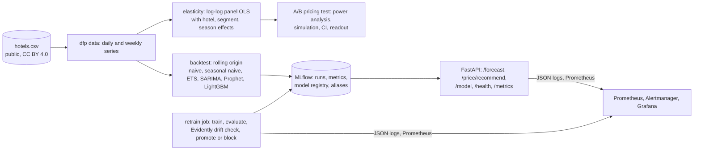

# Plan: demand-forecast-pricing

Goal: the work a pricing and forecasting data scientist hands to a revenue team, done end to end on public
data: a demand forecast that is honestly backtested against the baselines it has to beat, a price-elasticity
estimate with its caveats, a simulated A/B pricing test designed with a power analysis and read out the way
a business team needs it, and the operations around it: experiment tracking and a registry, an API, a
scheduled retrain that a drift check can block, and the usual tests, metrics and alerts.

Targets: Revenue Analytics (pricing, forecasting, segmentation); the 36% of AI/ML postings that ask for
statistics and the 24% that ask for A/B testing; data scientist roles.

## Data

Hotel booking demand dataset (Antonio, de Almeida and Nunes, *Data in Brief* 22, 2019, CC BY 4.0): 119,390
bookings at a city hotel and a resort hotel in Portugal, arrivals July 2015 to August 2017, with arrival
date, nights, guests, market segment, average daily rate (ADR), cancellation and more. Downloaded by
`scripts/download_data.py` from the TidyTuesday mirror; no account.

From it we build, per hotel and arrival date: arrivals (bookings that were not cancelled), room-nights,
revenue (ADR x nights) and mean ADR. Weekly aggregates per hotel and market segment feed the elasticity
model.

## Architecture

| Piece | Choice |
|---|---|
| Series | daily arrivals per hotel (the forecast target), plus room-nights, revenue and mean ADR; 793 days |
| Backtest | rolling origin, 12 folds stepping 14 days over the last ~6 months, horizons 7, 14 and 28 days; metrics MAPE, WAPE, sMAPE, MASE; every model refit per fold |
| Baselines | naive (last value) and seasonal naive (same weekday last week); a model that does not beat seasonal naive is reported as not beating it |
| Models | ETS and SARIMA (statsmodels), Prophet, LightGBM on lag and calendar features (direct per-horizon models), seasonal-naive-scaled ensembles considered only if they win |
| Elasticity | log(bookings) on log(ADR) with hotel, market-segment, month and year fixed effects at the hotel x segment x week level, HC3 standard errors; by hotel and by segment; stated as associational because ADR responds to demand in the data |
| A/B test | a 4-week price test on one hotel: treatment days get ADR x (1 + delta); outcomes simulated from the fitted demand model with the empirical residual distribution; power analysis for the minimum detectable effect on revenue per day; Welch t-test and bootstrap CI; a readout in plain language with the decision |
| Tracking | MLflow 3: one run per model per fold, nested under a backtest parent; the champion registered as `demand-forecast` with alias `production` |
| Serving | FastAPI: `/forecast`, `/price/recommend`, `/model`, `/health`, `/metrics`; API key and rate limit on the forecast and price routes; the model loaded from the registry alias at start-up and on `/model/reload` |
| Retrain | `dfp retrain`: refit the champion on the newest window, evaluate on the holdout, run Evidently data drift (current = latest 28 days, reference = the same weeks one year earlier; the gate judges the forecaster's input columns), compare with the production model; promote the alias only if no input drift and the holdout WAPE is not worse than 5% relative; otherwise write why it was blocked; weekly GitHub Actions schedule and a Compose job profile |
| Observability | structlog JSON, prometheus-client (request latency, forecasts served, model version, last retrain outcome, drift share), 5 alert rules with promtool tests, Grafana dashboard; OpenTelemetry traces optional |
| Deploy | Dockerfile (uv, non-root), Compose (api, mlflow, observability profile), `fly.toml`, Terraform for AWS App Runner + ECR as the IaC path (validated, not applied) |

## Numbers to produce

- WAPE and MAPE per hotel and horizon for every model against seasonal naive, from `dfp backtest`
  (`reports/backtest.json`, `reports/backtest.md`).
- Price elasticity with 95% CI overall, per hotel and per segment, from `dfp elasticity`.
- The A/B readout: minimum detectable effect at 80% power, the simulated test's lift with its CI and p-value,
  and the decision, from `dfp ab`.
- Retrain outcome and drift share from `dfp retrain` (`reports/retrain-latest.json`).

## Milestones

| # | Milestone | Done when |
|---|---|---|
| 1 | Data pipeline and series | unit tests on the aggregation; 793 days per hotel |
| 2 | Backtest with baselines and all models, MLflow logging | `reports/backtest.md` with every model vs seasonal naive |
| 3 | Elasticity | `reports/elasticity.json` with CIs and the caveat |
| 4 | A/B test design, simulation, readout | `reports/ab-readout.md` |
| 5 | Serving API with auth, rate limit, metrics; integration tests | `GET /forecast` from the registered model |
| 6 | Retrain job with Evidently gate; scheduled workflow | a run that promotes and a run that is blocked, both recorded |
| 7 | Observability, alerts with promtool tests, Compose, Dockerfile, Terraform, CI, Dependabot | all green locally |
| 8 | README, ADRs 0001-0005 | |

## Cost

Zero locally. Fly.io free allowance for the API, or AWS App Runner (about $5/month at the smallest size)
through the Terraform; both manual steps.

## Status (2026-10-17)

| # | Milestone | Status |
|---|---|---|
| 1 | Data pipeline and series | done: 793 days per hotel, quality report passes, 20 unit tests |
| 2 | Backtest | done: 6 models x 12 folds x 2 hotels in under a minute; champion SARIMA, WAPE 21.5% at h=14 vs 29.0% seasonal naive |
| 3 | Elasticity | done, with a diagnosis: the observational estimate is positive (simultaneity); pricing uses a stated planning assumption (ADR 0002) |
| 4 | A/B test | done: switchback readout shows the design is underpowered (MDE 17.9%); booking-level design brings it to 6.4% |
| 5 | Serving API | done: FastAPI with keys, rate limit, metrics, reload; integration-tested |
| 6 | Retrain job with Evidently gate | done: promote and blocked paths recorded and tested; weekly workflow |
| 7 | Observability, Compose, Dockerfile, Terraform, CI | done: 5 alert rules with promtool tests, App Runner Terraform validated, 7 CI jobs |
| 8 | README, ADRs | done |

Not done: deployment (needs his Fly.io or AWS account; `_portfolio/MANUAL-STEPS.md`).
